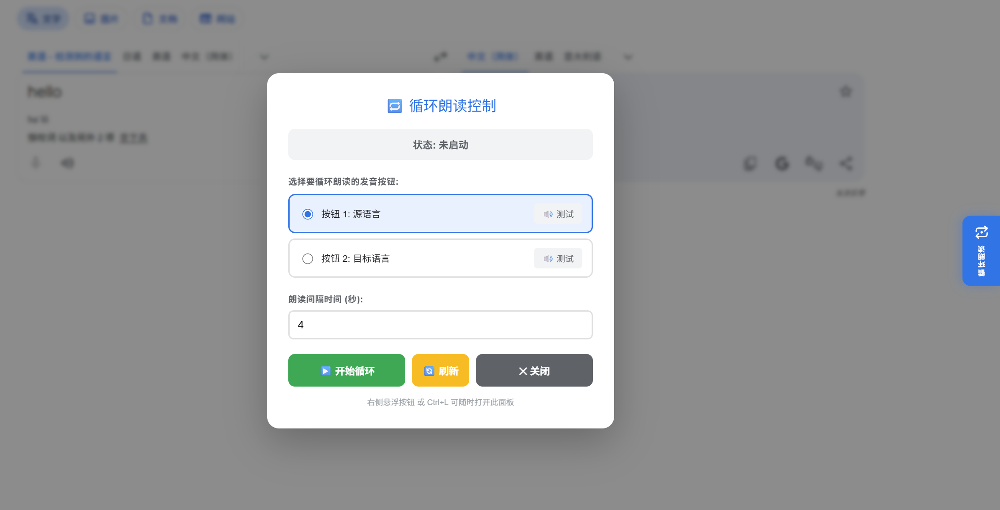

# Google Translate Loop Controller

Google Translate Loop Controller 是一个用于 Google 翻译网页的 Tampermonkey 用户脚本。它会在 Google 翻译页面右侧添加一个悬浮控制按钮，帮助用户循环播放源语言或目标语言的朗读音频，适合用于外语听力练习、发音跟读、词句复习等场景。

## 预览

## 功能特点

- 在 Google 翻译页面右侧显示“循环朗读”悬浮按钮。
- 支持通过 `Ctrl+L` 快捷键打开或关闭控制面板。
- 可选择循环朗读源语言或目标语言的发音按钮。
- 可手动测试当前识别到的朗读按钮。
- 支持设置每次播放结束后的等待间隔，范围为 1 到 60 秒。
- 播放中悬浮按钮会切换为高亮状态，方便识别当前是否正在循环。
- 通过监听 Web Audio 播放结束事件，在朗读完成后再进入下一轮等待。
- 内置 60 秒兜底超时，避免页面没有触发播放结束事件时循环卡住。

## 适用场景

- 反复听写 Google 翻译中的句子或单词。
- 练习目标语言发音、语调和节奏。
- 对比源语言与目标语言的朗读效果。
- 在语言学习时进行自动化重复播放，减少手动点击。

## 监听播放停止原理

Google 翻译的朗读音频通常会通过浏览器的 Web Audio API 播放。脚本会在页面加载后包装 `AudioContext` 和 `webkitAudioContext` 的 `createBufferSource` 方法，在每次页面创建 `AudioBufferSourceNode` 音频源时，为该音频源绑定 `ended` 事件监听器。

循环朗读开始后，脚本会先准备一个等待播放结束的 Promise，然后点击当前选中的 Google 翻译朗读按钮。当音频播放完成时，`AudioBufferSourceNode` 会触发 `ended` 事件，脚本据此判断本轮朗读已经结束，再按照用户设置的间隔时间等待，最后进入下一轮播放。

为了避免页面结构变化或浏览器行为导致 `ended` 事件没有触发，脚本还设置了 60 秒兜底超时。如果超过该时间仍未收到播放结束事件，会自动结束本轮等待，防止循环逻辑永久卡住。停止循环或页面卸载时，脚本也会清理定时器和等待状态，避免旧任务继续执行。

## 安装方式

1. 安装浏览器扩展 Tampermonkey。
2. 新建一个用户脚本。
3. 将 `GoogleTranslateLoopController.js` 中的代码粘贴到脚本编辑器。
4. 保存脚本并启用。
5. 打开 Google 翻译页面，即可看到右侧的循环朗读按钮。

## 使用方法

1. 打开 Google 翻译并输入需要朗读的文本。
2. 点击页面右侧的“循环朗读”悬浮按钮，或按下 `Ctrl+L`。
3. 在控制面板中选择要循环播放的发音按钮。
4. 根据需要设置播放结束后的等待间隔。
5. 点击“开始循环”开始自动朗读。
6. 需要停止时，再次打开控制面板并点击“停止循环”。

## 支持页面

脚本当前匹配以下 Google 翻译域名：

- `https://translate.google.com/*`
- `https://translate.google.com.hk/*`
- `https://translate.google.co.jp/*`

## 项目文件

- `GoogleTranslateLoopController.js`：Tampermonkey 用户脚本源码。
- `README.md`：项目介绍与使用说明。
- `preview.png`：项目预览图。

## 注意事项

- 脚本依赖 Google 翻译页面中的朗读按钮结构。如果 Google 更新页面结构，可能需要刷新控制面板或调整脚本选择器。
- 如果控制面板提示未找到发音按钮，请先输入文本并等待翻译结果加载完成，再点击“刷新”。
- 浏览器或页面可能会限制自动播放音频，首次使用时建议先手动点击一次 Google 翻译自带朗读按钮。
- `Ctrl+L` 在浏览器中通常用于聚焦地址栏。本脚本会在 Google 翻译页面中拦截该快捷键用于打开控制面板。
